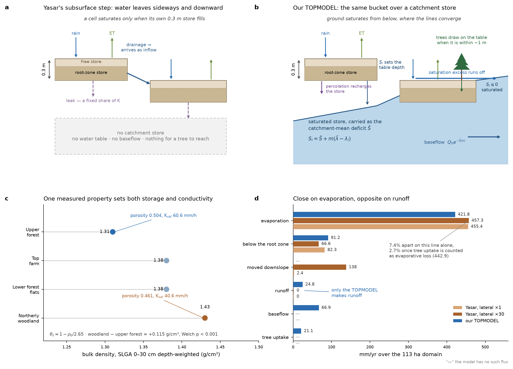
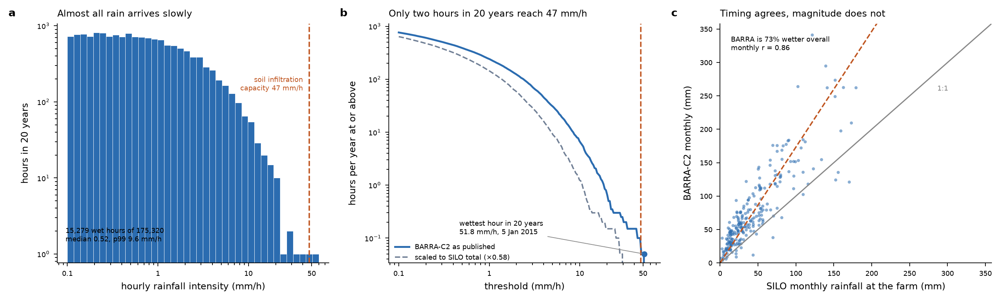

# terrasim-avonside

Two spatial models of soil water on one farm, run on the same prepared site, and the
figures that explain why they disagree.

The farm is **845 Avonside**, in the Snowy Mountains of New South Wales (−36.4355,
148.7257, 861 m). The modelled domain is 113 ha, **164 × 146 cells of 10 m**, driven by
**7,305 days** of SILO point weather (2006–2025).

This repository is a library plus its worked example. The library is a TOPMODEL step that
conforms to [TerraSim2](https://github.com/thestochasticman/TerraSim2)'s `StepFunction`
protocol and is not specific to this farm. The example is Avonside.

## Provenance — please read before reusing the model code

`src/terrasim_avonside/step_topmodel.py` is an **independent reimplementation** of the
TOPMODEL formulation, written to the `StepFunction` signature so it can be compared
against Yasar Arfat's subsurface bucket step on identical inputs. **No source code was
copied from any of his repositories.** At the time of writing,
`thestochasticman/DownscalingMoistureModel` carries no licence file and is therefore
all-rights-reserved; being on the same team is not a licence, because a downstream reader
has no way to know an internal arrangement exists. The comparison in this repository is
made from his method as presented, run through TerraSim2's own public API.

## How the two models differ



Both carry the same 0.3 m root-zone bucket on the same hillslope. The difference is
underneath it.

**Yasar's subsurface step** has a root-zone store and a free store above field capacity.
Water leaves downward as `leak`, a fixed share of conductivity, and sideways as `drainage`
to the downslope neighbour, where it arrives as `inflow`. There is no catchment store, so
there is no water table, no baseflow, and nothing for a tree root to reach. A cell
saturates only when its own store fills.

**Our TOPMODEL** keeps that bucket but puts a catchment store beneath it, carried as the
mean saturation deficit `S̄`. The local deficit `S_i = S̄ + m(λ̄ − λ_i)` sets the water
table depth; cells with `S_i ≤ 0` are saturated and shed rain as saturation excess;
percolation recharges the store; baseflow `Q₀·exp(−S̄/m)` drains it; and trees draw from
it when the table is within about a metre.

Bulk density is the single measured property that sets both how much the soil holds and
how fast it conducts, and it is the same input to both models. Across the four parts of
the farm it runs from 1.31 g/cm³ in the upper forest to 1.43 in the northerly woodland —
a difference of +0.115 g/cm³ (Welch p < 0.001) that carries porosity 0.504 against 0.461
and Ksat 60.6 against 40.6 mm/h.

### The result


The two models **agree closely on evaporation and disagree completely on runoff**, because
only the TOPMODEL lets ground saturate from below.

| mm/yr over the 113 ha | Yasar, lateral ×1 | Yasar, lateral ×30 | our TOPMODEL |
|---|---|---|---|
| evaporation | 455.4 | 457.3 | 421.8 |
| below the root zone | 82.3 | 66.6 | 91.2 (percolation) |
| moved downslope | 2.4 | 138.0 | — |
| runoff | 0.0 | 0.0 | **24.8** |
| baseflow | — | — | 66.9 |
| tree uptake | — | — | 21.1 |

On the evaporation line alone the models are 7.4% apart. They close to **2.7%** once the
TOPMODEL's 21.1 mm/yr of tree uptake is counted as evaporative loss, which it is — that
water is transpired. Quote whichever you mean, but say which. Disposal totals come to
537.7 mm/yr (Yasar ×1) and 534.6 (TOPMODEL) against 536.9 mm/yr of rain.

## Hourly rainfall



`data/barra/` holds 20 years of hourly precipitation from BARRA-C2 at the 4.4 km cell
serving the farm, pulled from NCI over OPeNDAP by `scripts/pull_barra_hourly.py`.
Precipitation is published only at 1-hourly; the 20-minute product carries wind variables,
not rain.

Two things the record settles:

- **BARRA-C2 is 73% wetter than SILO here** — 930.5 mm/yr against 536.9 at the farm point.
  Every calendar month is biased the same way and monthly r = 0.86, so the timing is
  usable and the magnitude is not. The correction factor to SILO's total is ×0.577.
  Do not substitute BARRA for SILO without applying it.
- **Rainfall intensity barely reaches the soil's infiltration capacity.** 8.7% of hours
  are wet at all, the median wet hour is 0.52 mm/h, and 98% of all rain falls at under
  10 mm/h. Exactly two hours in twenty years reach the 47 mm/h Ksat, and after the SILO
  bias correction none do. Infiltration-excess runoff is not the mechanism at this site;
  saturation from below is.

## What is not here

**Nothing in this repository is calibrated.** There is no streamflow gauge at Avonside, so
no local observation exists to calibrate against. `m`, `T₀` and specific yield are
plausible values, not fitted ones, and every flux above should be read as a comparison
between model structures rather than a prediction of the farm's water balance.

Two further caveats worth carrying:

- The split between evaporation and percolation is partly a labelling choice set by where
  the bottom of the root zone is drawn. Water called percolation at 0.3 m has only been
  handed to the material below 0.3 m, where tree roots may still reach it.
- The subsoil basin figure of 269 mm quoted elsewhere in this project is an **upper
  bound**: SLGA maps no specific yield for saprolite.

## Layout

```
src/terrasim_avonside/step_topmodel.py   the TOPMODEL StepFunction, with inline tests
scripts/pull_barra_hourly.py             the BARRA-C2 hourly pull
data/barra/                              20 years of hourly rain (CC BY — see its README)
docs/                                    figures
```

## Licence

Code in `src/` and `scripts/` is MIT (see `LICENSE`).

**`data/` is not covered by the MIT licence.** It holds Bureau of Meteorology BARRA-C2
reanalysis output, released under CC BY 4.0, with its attribution and citation
requirements set out in `data/barra/README.md`.
