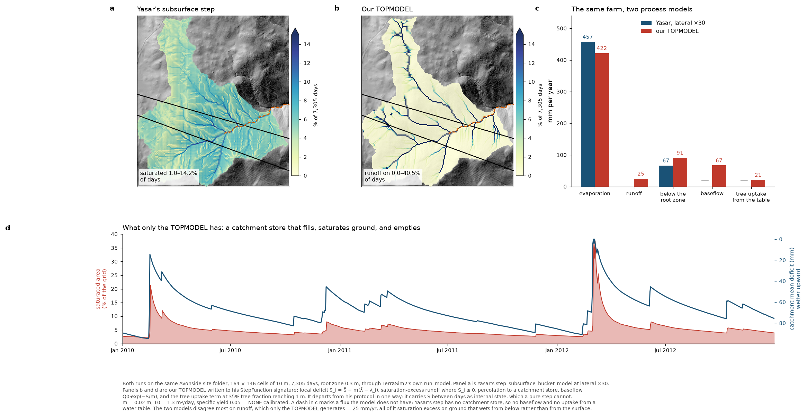
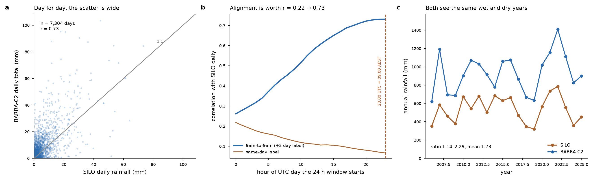
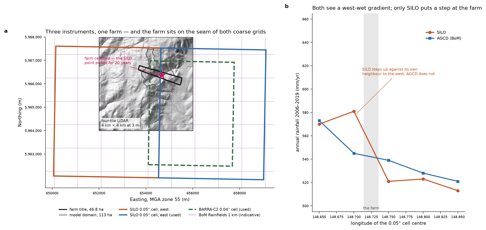
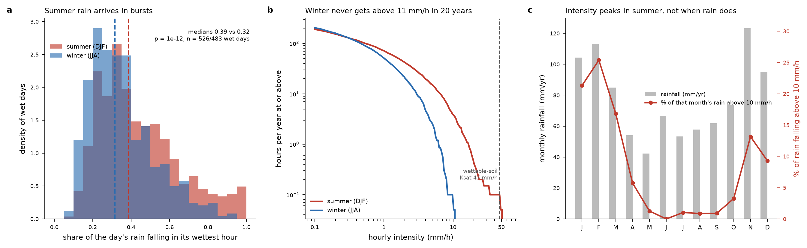
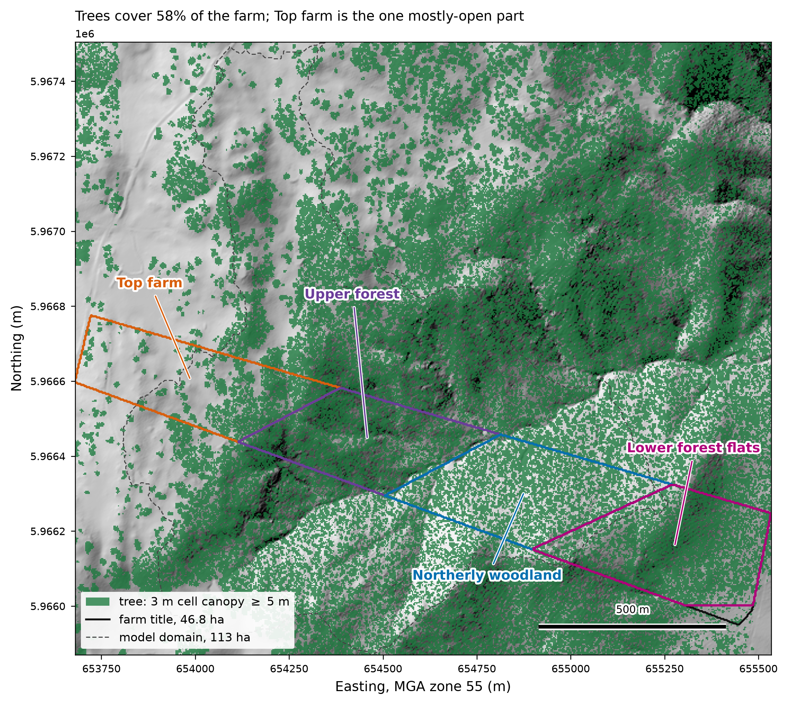

# terrasim-avonside

Two spatial models of soil water on one farm, run on the same prepared site, and the
figures that explain why they disagree.

The farm is **845 Avonside**, in the Snowy Mountains of New South Wales (−36.4355,
148.7257, 861 m). The modelled domain is 113 ha, **164 × 146 cells of 10 m**, driven by
**7,305 days** of SILO point weather (2006–2025).

This repository is a library plus its worked example. The library is a TOPMODEL step that
conforms to [TerraSim2](https://github.com/thestochasticman/TerraSim2)'s `StepFunction`
protocol and is not specific to this farm. The example is Avonside.

## Provenance — please read before reusing the model code

`src/terrasim_avonside/step_topmodel.py` is an **independent reimplementation** of the
TOPMODEL formulation, written to the `StepFunction` signature so it can be compared
against Yasar Arfat's subsurface bucket step on identical inputs. **No source code was
copied from any of his repositories.** At the time of writing,
`thestochasticman/DownscalingMoistureModel` carries no licence file and is therefore
all-rights-reserved; being on the same team is not a licence, because a downstream reader
has no way to know an internal arrangement exists. The comparison in this repository is
made from his method as presented, run through TerraSim2's own public API.

## How the two models differ


Both carry the same 0.3 m root-zone bucket on the same hillslope. The difference is
underneath it.

**Yasar's subsurface step** has a root-zone store and a free store above field capacity.
Water leaves downward as `leak`, a fixed share of conductivity, and sideways as `drainage`
to the downslope neighbour, where it arrives as `inflow`. There is no catchment store, so
there is no water table, no baseflow, and nothing for a tree root to reach. A cell
saturates only when its own store fills.

**Our TOPMODEL** keeps that bucket but puts a catchment store beneath it, carried as the
mean saturation deficit `S̄`. The local deficit `S_i = S̄ + m(λ̄ − λ_i)` sets the water
table depth; cells with `S_i ≤ 0` are saturated and shed rain as saturation excess;
percolation recharges the store; baseflow `Q₀·exp(−S̄/m)` drains it; and trees draw from
it when the table is within about a metre.

Bulk density is the single measured property that sets both how much the soil holds and
how fast it conducts, and it is the same input to both models. Across the four parts of
the farm it runs from 1.31 g/cm³ in the upper forest to 1.43 in the northerly woodland —
a difference of +0.115 g/cm³ (Welch p < 0.001) that carries porosity 0.504 against 0.461
and Ksat 60.6 against 40.6 mm/h.

### The result



The two models **agree closely on evaporation and disagree completely on runoff**, because
only the TOPMODEL lets ground saturate from below.

| mm/yr over the 113 ha | Yasar, lateral ×1 | Yasar, lateral ×30 | our TOPMODEL |
|---|---|---|---|
| evaporation | 455.4 | 457.3 | 421.8 |
| below the root zone | 82.3 | 66.6 | 91.2 (percolation) |
| moved downslope | 2.4 | 138.0 | — |
| runoff | 0.0 | 0.0 | **24.8** |
| baseflow | — | — | 66.9 |
| tree uptake | — | — | 21.1 |

On the evaporation line alone the models are 7.4% apart. They close to **2.7%** once the
TOPMODEL's 21.1 mm/yr of tree uptake is counted as evaporative loss, which it is — that
water is transpired. Quote whichever you mean, but say which. Disposal totals come to
537.7 mm/yr (Yasar ×1) and 534.6 (TOPMODEL) against 536.9 mm/yr of rain.

## Hourly rainfall


`data/barra/` holds 20 years of hourly precipitation from BARRA-C2 at the 4.4 km cell
serving the farm, pulled from NCI over OPeNDAP by `scripts/pull_barra_hourly.py`.
Precipitation is published only at 1-hourly; the 20-minute product carries wind variables,
not rain.



**Aligning the two is worth more than it looks.** SILO's day is the 24 hours ending at
9am, so the matching BARRA window starts at 23:00 UTC (09:00 AEST) and carries a two-day
label shift. Get that right and daily correlation is **r = 0.73**; align naively to UTC
midnight and it collapses to **r = 0.22**. The wet bias is also not a constant factor —
the annual ratio runs from 1.14 to 2.29 across the twenty years, so the ×0.577 correction
is an average, not a per-year fix. The 7,870 mm of 20-year excess partitions exactly as:
**+6,099 mm (78%)** extra rain on the 1,253 days both call wet, **+2,485 mm (32%)** on the
680 days SILO calls dry but BARRA rains, **+113 mm (1%)** on days both call dry, and
**−828 mm (−11%)** handed back on the 265 days SILO calls wet but BARRA does not. BARRA
has 1,933 wet days against SILO's 1,518 — the familiar reanalysis drizzle problem.

Two further things the record settles:

- **BARRA-C2 is 73% wetter than SILO here** — 930.5 mm/yr against 536.9 at the farm point.
  Every calendar month is biased the same way and monthly r = 0.86, so the timing is
  usable and the magnitude is not. The correction factor to SILO's total is ×0.577.
  Do not substitute BARRA for SILO without applying it.
- **Rainfall intensity barely reaches the infiltration capacity of a wettable soil.**
  8.7% of hours are wet at all, the median wet hour is 0.52 mm/h, and 98% of all rain
  falls at under 10 mm/h. Exactly two hours in twenty years reach the 47 mm/h Ksat, and
  after the SILO bias correction none do.

  **That conclusion is conditional, and the condition is not measured.** Ksat here is
  computed from texture and bulk density, so it is the conductivity of a *wettable* soil.
  Eucalypt litter is a well-known cause of soil water repellency, which can cut effective
  infiltration by an order of magnitude irrespective of pore space. At an effective
  10 mm/h the record already holds 134 hours over 20 years; at 5 mm/h, 616. So
  infiltration-excess runoff cannot be ruled out under the forest and woodland litter,
  particularly after a dry spell, and the question is a field measurement — water-drop
  penetration time or a mini-disk infiltrometer under litter against adjacent grass —
  not something a reanalysis can settle.

## Which rainfall do you believe?



The farm is smaller than two of the three instruments that measure its rainfall, and it
sits on the seam of both coarse grids.

SILO's Data Drill grid is 0.05°, with cell edges here at lon 148.725/148.775 and lat
−36.475/−36.425 (measured by scanning the API, not read from documentation). The farm
centroid lies about **60 m inside the western edge** of its cell, so the property
straddles two: 44.5% of the title and **72.4% of the model domain fall in the cell to the
west**, which the 20-year forcing never used. BARRA-C2's 0.04° cell edge at lon 148.720
splits the farm too, leaving 26% of the domain outside the pixel we sampled.

| | mm/yr |
|---|---|
| SILO east cell — used for the 20-year forcing | 536.9 |
| SILO west cell | 607.7 |
| BARRA-C2 cell, as published | 930.5 |

**But do not correct the forcing on that basis.** BoM's own gridded analysis, AGCD, sits
on the *same* 0.05° grid and was pulled from NCI for 2006–2019. The two products agree on
daily rainfall almost perfectly (r = 0.976) and on a broad west-wet gradient across the
window — and they disagree completely about where it steepens. Along latitude −36.45,
AGCD declines smoothly from west to east (573, 545, 539, 528, 521 mm/yr) while SILO is
**non-monotonic**, stepping *up* to 581 at the farm's western cell against 570 in the cell
further west, then dropping 60 mm in one cell.

Weighting by where the model domain actually lies therefore gives **+8.4% under SILO but
only +0.8% under AGCD**. A gradient that one interpolation places exactly on the property
boundary and the other does not place at all is an artefact of interpolation, not a
measurement. Treat the farm's rainfall as **540–565 mm/yr with the upper end unsupported**,
and do not silently adopt the SILO west cell as a correction.

**Gauges, and which ones are real.** Of the stations within 60 km, several nearby records
are entirely interpolated: Oak Vale (7.7 km) and Jindabyne (10.7 km) are **0% observed**
over 2006–2025 — the stations are closed and SILO is infilling them. Six stations are
genuinely observing, and they are almost all to the east:

| station | km | elevation | observed | mm/yr |
|---|---|---|---|---|
| Berridale (Bolton St) | 11.8 E | 895 m | 94.9% | 553.9 |
| Dalgety (Hamilton St) | 12.7 E | 775 m | 97.5% | 534.8 |
| **Jindabyne (Glochinbah)** | **13.4 W** | **990 m** | **96.6%** | **654.8** |
| Dalgety (Severn Park) | 19.0 E | 895 m | 93.3% | 531.8 |
| Cooma Airport AWS | 27.2 E | 930 m | 99.0% | 558.6 |
| Cooma (Myalla) | 34.5 E | 1042 m | 94.5% | 608.7 |

The single operating western gauge is **18% wetter than the nearest eastern one**, which
supports a west-wet gradient at the 25 km scale — though Glochinbah is also 95 m higher,
so elevation and longitude cannot be separated with one western gauge. Across these
six, rainfall rises about 40 mm/yr per 100 m of elevation, though with n = 6 and elevation
confounded with longitude the fit is weak (r² = 0.58, p = 0.08) and should not be leaned
on hard.

**And the farm is higher than SILO thinks it is.** SILO reports 861 m for its cell. The
four farm parts average 1175 m (Top farm), 1055 m (Upper forest), 995 m (Northerly
woodland) and 951 m (Lower forest flats) — 224 m of internal relief, all of it above the
cell elevation. Taken with the gradient above that implies a real within-farm rainfall
range, and that every part of the farm is wetter than the forcing says.

## Summer and winter rain are different processes



Splitting the hourly record by season separates the two rainfall regimes cleanly:

- On wet days, the wettest hour carries a median **39% of summer daily rain against 32%
  in winter** (Mann-Whitney p ≈ 1e-12, n = 526/483 wet days).
- **19.1% of summer rain falls at more than 10 mm/h, against 0.6% of winter rain** — a
  32-fold difference.
- The wettest winter hour in twenty years is **11.0 mm/h**; the wettest summer hour is
  **51.8 mm/h**.

So whatever runoff intensity can generate at this site, it is a **summer process
exclusively**. That matters for the water-repellency question above, because summer is
also when the soil is driest and eucalypt-litter repellency is strongest — the two
mechanisms peak together rather than cancelling.

## Vegetation



`data/vegetation/` carries fractional tree cover on the model grid, so `tree_root_depth`
can separate grass from trees. Trees cover **58.2% of the 46.8 ha title** and 55.3% of the
113 ha model domain at a 5 m canopy cut — Top farm 33.8%, Upper forest 65.7%, Northerly
woodland 64.8%, Lower forest flats 69.6%. Dropping the cut to 4 m adds 1.67 ha farm-wide.

The 5 m cut is the one validated against the field-checked crown inventory, and it
behaves: of 17 inventory trees and 16 low linear objects known not to be trees, a 3 m
search radius finds all 17 trees and still admits only 5 of the low objects — and two of
those stood above 5 m in the 2018 lidar and are low now, which is a fallen or died-back
stem rather than a threshold failure. See `data/vegetation/README.md` for the caveats
that govern these numbers, especially that the lidar is 2018 and crowns have fallen a
median 3.3 m since.

## What is not here

**Nothing in this repository is calibrated.** There is no streamflow gauge at Avonside, so
no local observation exists to calibrate against. `m`, `T₀` and specific yield are
plausible values, not fitted ones, and every flux above should be read as a comparison
between model structures rather than a prediction of the farm's water balance.

Two further caveats worth carrying:

- The split between evaporation and percolation is partly a labelling choice set by where
  the bottom of the root zone is drawn. Water called percolation at 0.3 m has only been
  handed to the material below 0.3 m, where tree roots may still reach it.
- The subsoil basin figure of 269 mm quoted elsewhere in this project is an **upper
  bound**: SLGA maps no specific yield for saprolite.

## Layout

```
src/terrasim_avonside/step_topmodel.py   the TOPMODEL StepFunction, with inline tests
scripts/pull_barra_hourly.py             the BARRA-C2 hourly pull
data/barra/                              20 years of hourly rain (CC BY — see its README)
docs/                                    figures
```

## Licence

Code in `src/` and `scripts/` is MIT (see `LICENSE`).

**`data/` is not covered by the MIT licence.** It holds Bureau of Meteorology BARRA-C2
reanalysis output, released under CC BY 4.0, with its attribution and citation
requirements set out in `data/barra/README.md`.
